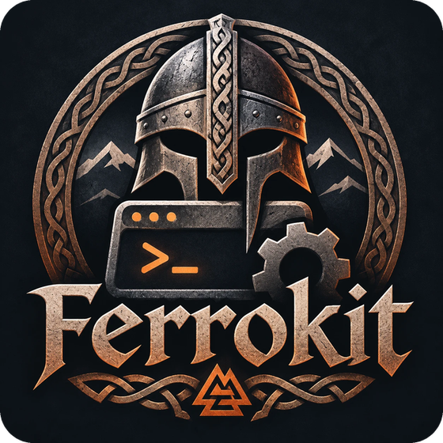
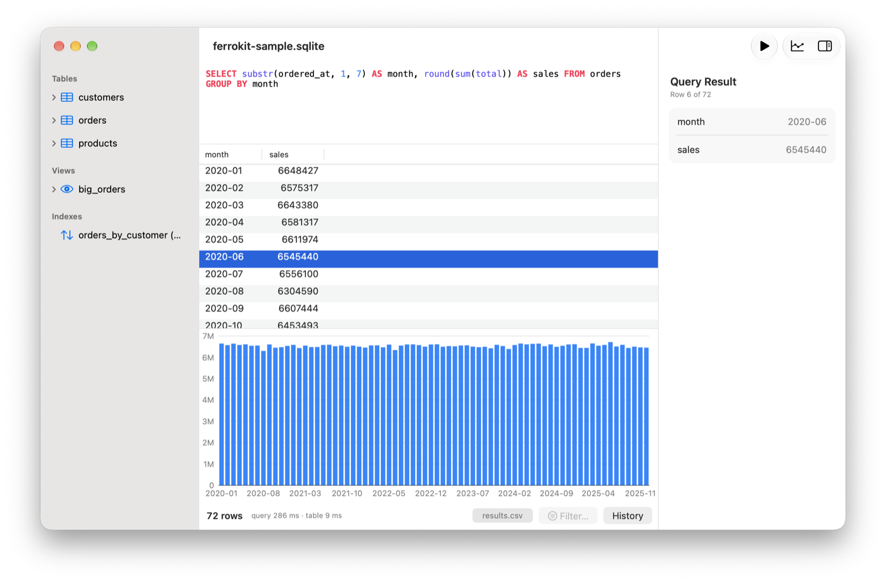
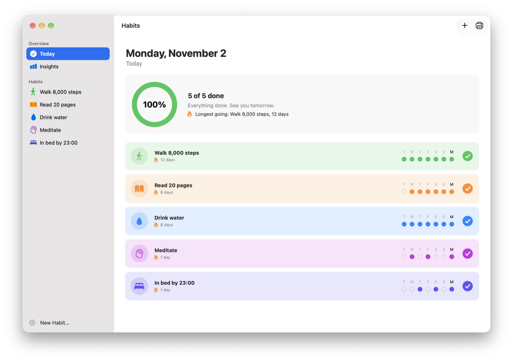
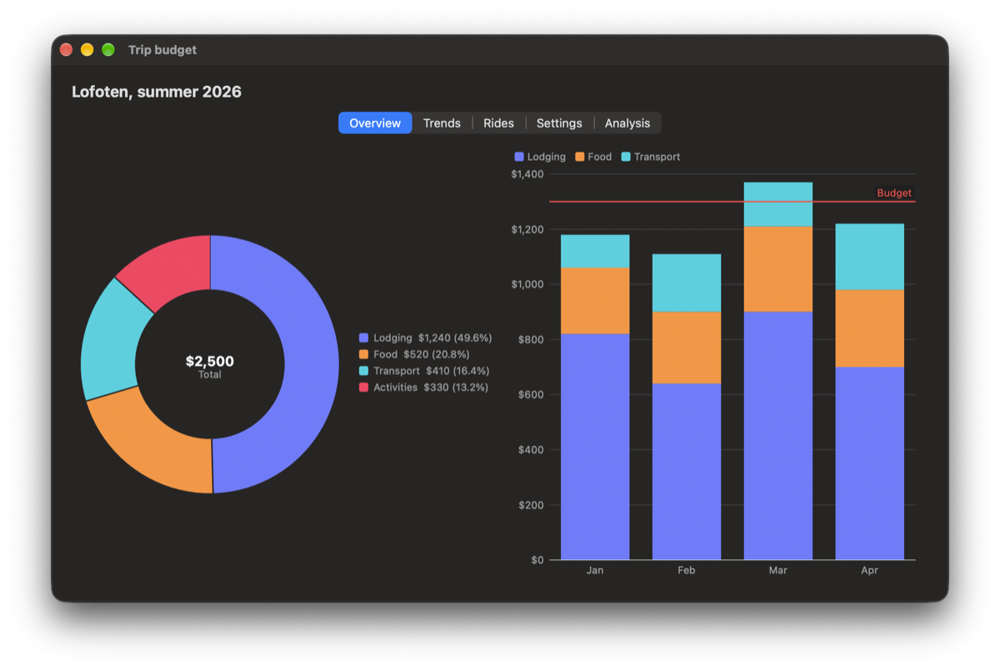

<p align="center"></p>

# Ferrokit

**Mac apps in Rust that are actually Mac apps.**

Ferrokit is a native macOS GUI framework for Rust: every view is a real AppKit control, built once and updated in place by fine-grained signals.

It builds your UI from the real thing: an actual `NSTableView`, `NSTextView`, `NSSplitView` and `NSPopover`. It isn't a web view, and it isn't a GPU renderer doing an impression of AppKit. So the details Mac users notice are right because they're Apple's own: scrolling, keyboard navigation, spell check, Dark Mode, VoiceOver.

It's built on [objc2](https://github.com/madsmtm/objc2) and `objc2-app-kit`, the Rust bindings generated from Apple's own SDK headers, so when you need an AppKit class Ferrokit doesn't wrap, you can still reach it.

Rowboat, a SQLite editor for the Mac, is built with Ferrokit and is waiting for review in the Mac App Store.



https://github.com/user-attachments/assets/47f03091-6c3d-4e5b-a77d-bddb544e64e1

<p>
  
  
</p>

## See it in one command

```bash
git clone https://github.com/lhassa8/ferrokit && cd ferrokit && cargo run --release -p ferrokit --example sql_browser
```

That's a SQLite browser over a generated sample of a million orders. Click `orders` and all million rows appear in about a fifth of a second. Then try these:

- **Fling the table:** scroll as fast as you can, then sort by `total`.
- **Run a query:** as you type it's highlighted, ⌘R runs it, and ⌥⌘K charts it.
- **Drag a result out:** drag the `results.csv` chip into Finder, and a real file lands there.
- **Switch to Dark Mode:** everything follows, mid-query.

## What you get without writing it

When a view is the real AppKit control, a long list of features comes with it:

- **Spell check:** right-click a misspelled word in any text view for suggestions, as in Mail.
- **Find:** ⌘F opens the system Find bar, and ⌘Z undoes per window.
- **Input methods:** Japanese, Chinese and Korean input and the emoji picker just work, because it's Apple's text system.
- **VoiceOver:** it reads AppKit's own accessibility tree, and `testing::ax_audit` finds controls you forgot to name.
- **Keyboard:** Tab order, arrow keys in tables and outlines, Return on default buttons.
- **The new look:** Dark Mode, accent colours, sidebar materials, and Liquid Glass on macOS 26.
- **The system's services:** the Share menu (AirDrop, Mail, Messages), Quick Look, printing, notifications, and drag and drop with Finder.

## What the code looks like

Views are built once. When a signal changes, only the views that read it update, in place: there's no virtual DOM and no diffing.

```rust,ignore
use ferrokit::*;

fn main() {
    let count = Signal::new(0);
    App::new("Counter")
        .window(Window::new("Counter").size(320.0, 140.0).view(
            vstack((
                text(move || format!("Clicked {} times", count.get())),
                button("Click me", move || count.update(|n| *n += 1)),
            ))
            .padding(20.0),
        ))
        .run();
}
```

A table is your rows and the columns that read them. Header clicks sort it, and only the rows on screen get views:

```rust,ignore
let model = Rc::new(TableModel::new(ViewId(1), vec![
    Column::text("customer", "Customer", |o: &Order| o.customer.clone()),
    Column::number("total", "Total", |o: &Order| o.total),
    Column::check("paid", "Paid", |o: &Order| o.paid),
]));
model.set_rows(orders); // 200,000 rows load in about 5 ms
let view = table(&model).on_activate(|row| println!("opened row {row}"));
```

The [guide](crates/ferrokit/guide/README.md) has the rest in 14 chapters, and every example in it compiles as a test.

## The example apps

Ferrokit comes with complete apps rather than toy demos. Each one also runs as a self-check suite (`CHECK=all`):

| Run it with `--example` | What it is | Look at |
| --- | --- | --- |
| `sql_browser` | A SQLite browser | A million-row table, a SQL editor with highlighting, charts, an inspector, and query history |
| `habits` | A habit tracker | Cards with a progress ring, streak calendars, Insights charts, reminders, and a menu-bar panel |
| `components` | A trip budget | Donut, stacked-bar, area, scatter, histogram and heat-map charts, plus gauges, ratings and token fields |
| `motion` | A packing list | Rows sliding in and out, a spring that opens a details panel, a shake when there's nothing to remove |
| `materials` | A travel journal | A transparent title bar, a sidebar behind the window buttons, Liquid Glass, a HUD panel |
| `media` | A trip briefing | A web view, a PDF with Find, a video player, the Share menu, Quick Look |
| `log_viewer` | A live log viewer | Following a growing file of a million lines at 60 Hz |
| `gallery` | A grid browser | 100,000 colour swatches, or your Applications folder with Finder icons |
| `journal` | A rich text journal | The format bar, the ruler and the Format menu, saving RTF as TextEdit does |

```bash
cargo run --release -p ferrokit --example habits
```

## From idea to notarised app

`cargo ferrokit` takes an app from an empty folder to a signed `.app` you can share:

```bash
cargo install cargo-ferrokit
```

```bash
cargo ferrokit new my-app && cd my-app && cargo ferrokit run
```

| Command | What it does |
| --- | --- |
| `run` | Builds a real `.app` bundle, with its name, icon and identity, and runs it |
| `preview` | Runs it, then rebuilds and restarts it every time you save, with its windows where you left them |
| `check` | Clippy, tests, a bundle, and your app's own self-checks |
| `agents` | Writes `AGENTS.md` into an existing app, for your AI coding assistant |
| `bundle` | A signed `.app` with the hardened runtime, universal on request |
| `notarize` | Developer ID signing, Apple's notary service and stapling, then a zip ready to send |
| `appcast` | Updates through Sparkle: the release zipped and the feed written; the app has Check for Updates… |
| `bundle --app-store` | A universal, sandboxed app in a signed installer package for the Mac App Store |

## Bring your AI assistant

If Claude Code, Cursor or Codex writes most of your code, it can learn Ferrokit from what ships with it:

- **`AGENTS.md`:** where the docs are, how a Ferrokit app is written, recipes that compile, and the known limits with their workarounds. `cargo ferrokit new` puts it in every new app, and `cargo ferrokit agents` in an existing one.
- **`API.md`:** every public item on one page, in the crate beside `AGENTS.md`. The guide is [on docs.rs](https://docs.rs/ferrokit/latest/ferrokit/guide/).
- **Tested with agents:** fresh AI agents given only the published 0.6 docs each built a working app (an expense tracker and a Markdown editor) with one compile error between them. What tripped them up is fixed in 0.7.

## Is it for me?

**Yes, if:**
- you want a Mac app that feels like it came from Apple;
- your app is heavy on data: tables, editors, outlines, logs, charts;
- you'd rather write Rust than Swift.

**Not yet, if:**
- you need Windows or Linux. Ferrokit is Mac only for now, and Windows is the planned second platform. Cross-platform toolkits such as Tauri, egui, Iced, Slint and GPUI are the tools for that today; they draw their own widgets or use a web view.
- you need a stable API. It's an alpha (0.8), and the API will still change.

## Testing it like you mean it

Ferrokit tests itself with real apps. About 500 self-checks across 18 example apps click real buttons, type into real text views and read back what AppKit did. They run in release and debug builds and in the App Sandbox, on macOS 15, 26 and the newest beta. Your app gets the same tools: `ferrokit::testing` and `cargo ferrokit check`.

## Built something?

Ferrokit is new, and you could be one of its first users. If you build anything with it, even a weekend toy, [open an issue](https://github.com/lhassa8/ferrokit/issues) and show it off. Bug reports and "how do I…" questions are just as welcome.

---

## Which crate do I want?

Use [`ferrokit`](crates/ferrokit), with [`cargo ferrokit`](crates/cargo-ferrokit) to make, check and bundle your app.

| Crate | What it is |
| --- | --- |
| [`ferrokit`](crates/ferrokit) | The framework: whole Mac apps where every view is a real AppKit view, updated in place by fine-grained signals. |
| [`cargo-ferrokit`](crates/cargo-ferrokit) | `cargo ferrokit new`, `run`, `preview`, `check`, `agents`, `bundle`, `notarize` and `appcast`. |
| [`ferrokit-core`](crates/ferrokit-core) | The AppKit layer under `ferrokit`. You don't need to depend on it yourself. |

The crates share one version number and are released together, so use matching versions. The current version is **0.8.0**. It needs macOS 15 or later.

## Stability

Ferrokit is an alpha. It promises the following.

- **Versions:** while it's 0.x, a minor release (0.4 → 0.5) may change the API; a patch release (0.4.0 → 0.4.1) never does. Every change that breaks code is listed in the CHANGELOG with what to write instead, and a renamed item keeps working, deprecated, for one minor release where it can.
- **One version:** the crates are released together under one version; `ferrokit` pins `ferrokit-core` exactly.
- **macOS:** 15 or later. Checked on macOS 15 and the current release (CI), and on the newest beta locally. Each macOS release is checked when it ships; AppKit changes (macOS 27 turned column browser cells into text cells) are fixed in a patch.
- **Rust:** the latest stable; the minimum (`rust-version`, 1.88) only rises in a minor release.
- **Failures:** an Objective-C exception or a panic in code AppKit calls is caught where it came in, reported (`App::on_error`) and survived, never silently dropped.
- **Checks:** every change runs the self-checks above (`scripts/check-all.sh`).

## Earlier names

Until 0.4 the crates were called `appkit-ui` (now `ferrokit`) and `appkit-host` (now `ferrokit-core`); the old names' last releases re-export the new crates. `iced-appkit`, real AppKit views inside Iced windows, stays at 0.2.1 and isn't continued: Ferrokit is one framework now.

## Working on Ferrokit

Contributions are very welcome, small ones included: see [CONTRIBUTING.md](CONTRIBUTING.md) for how to build and check it, issues labelled [`good first issue`](https://github.com/lhassa8/ferrokit/labels/good%20first%20issue) for a place to start, [Discussions](https://github.com/lhassa8/ferrokit/discussions) for questions, and [ROADMAP.md](ROADMAP.md) for where it's going. `scripts/check-all.sh` runs every check: build, clippy, tests, docs, and each example app's unattended self-checks.

**How it's made and maintained:** Ferrokit is developed by one person, Lars Tray, with a lot of help from an AI coding assistant. Every behaviour has a self-check that runs the real app, and CI runs them on two macOS versions. The full development history is in this repository. I build my own apps on it (Rowboat, a SQLite editor, is the first), so it gets fixed when AppKit changes. Being one person is a real limit, and more maintainers would make it a safer bet; if you'd like to help, say hello in Discussions.

## License

MIT OR Apache-2.0, at your option.
