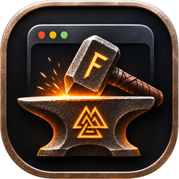

# cargo-ferrokit

Make, run, check, bundle and notarize native Mac apps built with
[`ferrokit`](https://crates.io/crates/ferrokit).

```bash
cargo install cargo-ferrokit
```

```bash
cargo ferrokit new my-app
```

```bash
cd my-app && cargo ferrokit run
```

| Command | What it does |
| --- | --- |
| `new <path> [--document]` | A new app: a to-do list, or a text document app, with self-checks and an `AGENTS.md` for AI coding assistants. |
| `run [--release]` | Builds, bundles and runs the app (its name, icon and identity), output in the terminal. |
| `preview` | Runs the app, then rebuilds and restarts it on every save: windows where you left them, the editor keeps the focus, a failed build leaves the app running. |
| `check` | Clippy (warnings are errors), tests, a bundle, the app's self-checks (`CHECK=all`), the signature. |
| `agents [--force]` | Writes `AGENTS.md` (and a `CLAUDE.md` that points to it) into an app that wasn't made with `new`, or brings it up to this version: what an AI coding assistant needs to write a Ferrokit app. |
| `bundle [--universal] [--zip]` | A signed `.app` with the hardened runtime (ad hoc, or your Developer ID). |
| `notarize [--dry-run]` | Developer ID signing, Apple's notary service, stapling, a zip to share. |
| `appcast [--key-file <file>]` | Updates through Sparkle: zips the bundled app into `updates/` and writes the feed (Sparkle's `generate_appcast`), ready to upload. |
| `bundle --app-store [--build <n>] [--dry-run]` | For the Mac App Store: universal, sandboxed, the provisioning profile embedded, Apple Distribution signing, a signed `.pkg` for Transporter. |

Settings live in the app's `Cargo.toml`:

```toml
[package.metadata.ferrokit]
name = "My App"
id = "com.example.myapp"
icon = "icon.png"          # square PNG (1024 px) or .icns
min-macos = "15.0"
category = "public.app-category.productivity"
languages = ["de", "fr"]   # its translations, besides English
sign = "Developer ID Application: Your Name (TEAMID)"
notary-profile = "my-profile"   # xcrun notarytool store-credentials my-profile …
sandbox = true                  # sign for the App Sandbox (files the user chooses, bookmarks)
network = true                  # with the sandbox: outgoing connections
app-store-sign = "Apple Distribution: Your Name (TEAMID)"            # bundle --app-store
installer-sign = "3rd Party Mac Developer Installer: Your Name (TEAMID)"
provisioning-profile = "MyApp.provisionprofile"                      # a Mac App Store profile

[[package.metadata.ferrokit.documents]]
name = "Text"
extensions = ["txt", "md"]

[package.metadata.ferrokit.updates]   # updates through Sparkle 2
feed = "https://example.com/myapp/appcast.xml"
public-key = "…"                      # what Sparkle's bin/generate_keys prints
sparkle = "~/Developer/Sparkle-2.10.1"   # Sparkle's release, unpacked (or FERROKIT_SPARKLE)

[package.metadata.ferrokit.entitlements]   # more entitlements, as Apple names them
"com.apple.security.print" = true          # printing from the sandbox

[package.metadata.ferrokit.plist]          # more Info.plist keys
ITSAppUsesNonExemptEncryption = false      # export compliance, for the App Store
NSHumanReadableCopyright = "© 2026 Your Name"
```

A setting it doesn't know, or one of the wrong type (`sandbox = "true"`),
is an error, so a misspelt key can't quietly leave the sandbox off. The
extra tables take `true`/`false`, strings and lists of strings.

With `updates` set, `bundle` embeds and signs `Sparkle.framework` and the
app gets Check for Updates… (see the guide's *Testing and shipping*
chapter).

macOS only. It runs Apple's tools (`codesign`, `plutil`, `sips`,
`iconutil`, `lipo`, `ditto`, `xcrun notarytool`, `stapler`, `spctl`), which
come with the Command Line Tools; `appcast` runs Sparkle's `generate_appcast`.

License: MIT OR Apache-2.0.
